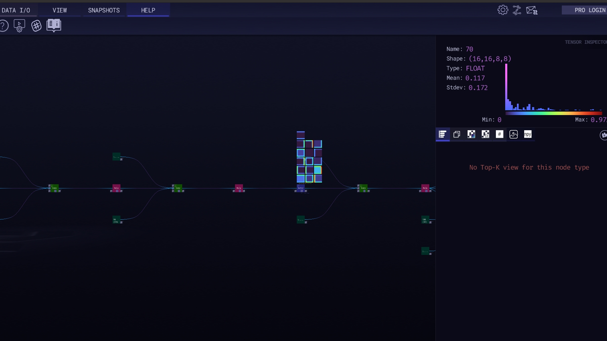

# 简介

"免费的Zetane Viewer是一个帮助理解和加速机器学习和人工神经网络发现的工具。它可以通过可视化和理解模型的架构和内部数据（特征图、权重、偏差和层输出张量）来打开AI黑箱。它可以被认为是一种用于神经成像或大脑成像的工具，用于人工神经网络和机器学习算法。"

github:地址：https://github.com/zetane/viewer?tab=readme-ov-file


## 安装

```
sudo dpkg -i Zetane-1.7.4.deb
```

## 使用

加载模型

查看想要的数据




